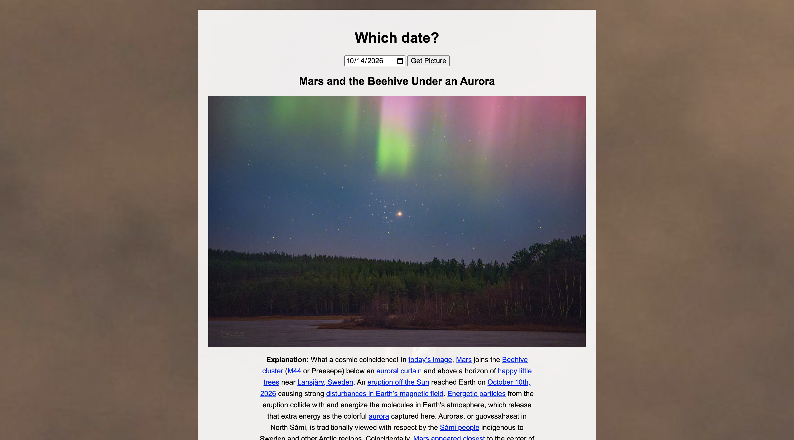

# NASA Picture of the Day 🚀

Pick a date and see NASA's Astronomy Picture of the Day from that day, with its title and description.

## Description

This is a project I built to practice using an API with user input. You choose a date, click the button, and the page asks NASA's Astronomy Picture of the Day for that day's picture. It then shows the picture's title and description under the date picker. Some days NASA posts a video instead of a picture, so the page can show either one. It uses plain HTML, CSS, and JavaScript with `fetch`, so there is no server to run.

## Screenshot

## Features

- Pick any date with a date picker
- Shows NASA's picture for that day
- Shows the title and the full description
- Works for video days too: it shows NASA's preview picture and a link to watch the video on NASA's site
- Shows a friendly message if you don't pick a date or pick a date NASA doesn't have
- Everything is centered in one column on top of a space shuttle launch photo

## Tech Used

- HTML
- CSS
- JavaScript
- `fetch` and promises (`.then()` and `.catch()`)
- NASA's Astronomy Picture of the Day, from science.nasa.gov (no API key needed)

## How to Use

This app doesn't need a server or an API key.

1. Download or clone the project.
2. Open `index.html` in your browser (or use the Live Server extension in VS Code).
3. Pick a date from June 16, 1995 up to today.
4. Click **Get Picture**.

## How It Works

1. When you click the button, `main.js` reads the date you picked. If there isn't one, it asks you to pick a date.
2. It turns the date into the format NASA uses at the end of its web address (2014-09-18 becomes 140918) and uses `fetch` to ask for that day.
3. It puts the title in the heading and the explanation in the description.
4. It shows the picture. If that day is a video, it shows the preview picture with a link to watch the video on NASA's site.
5. If NASA doesn't have that date, it shows a message instead of a broken page.

## What I Learned

- How to use `fetch` and `.then()` to get data from an API
- How to use a date from an input in a request
- How to find out when an API stops working, and switch to one that does
- How to show an image or a video depending on what the API sends back
- How to show and hide elements with JavaScript
- How to center a page and set a background image with CSS
- How to handle errors when a date isn't available

VIEW APP HERE: https://simple-nasa.onrender.com/s

## Author

Maya Rose 🌹
